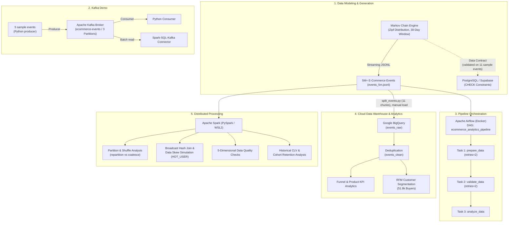

# 🛒 End-to-End E-Commerce Data Engineering & Analytics Project

An end-to-end data engineering project built to simulate, validate, orchestrate, store, and analyze **5,000,000+ synthetic e-commerce user behavior events**.

The project covers **probabilistic Markov chain data generation**, **relational data contracts on PostgreSQL**, **batch pipeline orchestration with Apache Airflow**, **cloud data warehousing and customer analytics on Google BigQuery**, **distributed processing and data quality checks with Apache Spark (PySpark)**, and a **Kafka producer/consumer demo with Spark integration**.

> **Note:** All data in this repository is synthetic. Results demonstrate the pipeline and methods, not real customer behavior.

---

## 🏛️ System Architecture



---

## 🛠️ Tech Stack & Capabilities

| Layer | Technologies | Responsibilities |
| :--- | :--- | :--- |
| **Data Generation & Modeling** | Python, Markov Chains, Zipf's Law | Event-driven simulation, memory-safe JSONL streaming (100K, 1M, 5M events). |
| **Relational Data Contract** | PostgreSQL, Supabase | Schema design, table relationships, CHECK constraints and negative tests. |
| **Pipeline Orchestration** | Apache Airflow, Docker, Celery, Redis | Batch pipeline (prepare → validate → analyze) with retry policy and monitoring. |
| **Cloud Data Warehouse** | Google Cloud BigQuery, SQL | Deduplication, funnel analysis, search analytics, and RFM customer segmentation. |
| **Distributed Processing** | Apache Spark (PySpark 4.0.1) | Partition/shuffle analysis, broadcast join, data skew simulation, historical CLV, cohort analysis. |
| **Messaging** | Apache Kafka 4.0, Docker | Producer/consumer demo (5 sample events), partition vs. offset analysis, Spark batch read via connector. |
| **Data Quality** | PySpark | 5-dimensional validation (Duplicates, Missing, Invalid, Inconsistency, Anomaly). |

---

## 📂 Repository Structure

```plaintext
ecommerce-data-pipeline/
├── data-generation/                   # Markov chain synthetic data engine
│   ├── generate_events.py             # Streaming generator (set TARGET_EVENTS: 100k, 1M, 5M)
│   ├── validate_events.py             # Rule-based validation (session timeout, limits)
│   ├── analyze_data.py                # Funnel, KPI and Markov transition analysis
│   ├── analyze_events.py              # Event frequency and session counter utility
│   ├── split_events.py                # Splits the 972 MB file into 11 parts for BigQuery
│   └── sample_events.jsonl            # Small sample dataset for quick testing
├── orchestration/                     # Workflow automation with Apache Airflow
│   ├── dags/
│   │   └── ecommerce_pipeline.py      # Airflow DAG (prepare -> validate -> analyze)
│   ├── docker-compose.yaml            # Multi-container Airflow setup (Celery + Redis)
│   └── config/                        # Airflow configuration files
├── spark-analytics/                   # PySpark jobs
│   ├── 01_spark_basics.py             # Loading 5M events, schema, filter/select/groupBy
│   ├── 02_partition_shuffle_skew.py   # repartition vs coalesce, broadcast join, skew simulation
│   ├── 03_customer_analytics_clv_cohort.py # RFM, historical CLV, cohort analysis
│   ├── 04_data_quality_checks.py      # 5-dimensional data quality audit
│   └── data/                          # Sample data for PySpark jobs
├── kafka-streaming/                   # Kafka demo
│   ├── kafka_producer.py              # Sends 5 sample events (one per event type)
│   ├── kafka_consumer.py              # Consumer logging partitions and offsets
│   └── kafka_spark.py                 # Spark batch read via Kafka connector, partition comparison
├── sql/                               # SQL files
│   ├── supabase_schema_and_contract.sql # PostgreSQL DDL with CHECK constraints
│   ├── bigquery_analytics.sql         # Deduplication, funnel, product and search analytics
│   └── bigquery_rfm_segmentation.sql  # User-level RFM scoring and segment assignment
├── .gitignore                         # Excludes multi-GB dataset files
├── requirements.txt                   # Python dependencies
└── README.md
```

---

## 🔬 Key Engineering Highlights & Methodologies

### 1. Probabilistic Markov Chain Simulation
Instead of fixed scenarios, user sessions are generated by a Markov process. Each session starts with `PRODUCT_LIST_VIEW` and moves between states using calibrated transition probabilities:

| From | To (probability) |
| :--- | :--- |
| `PRODUCT_LIST_VIEW` | `SEARCH` (30%), `PRODUCT_DETAIL_VIEW` (50%), `END` (20%) |
| `SEARCH` | `SEARCH` (15%), `PRODUCT_DETAIL_VIEW` (65%), `END` (20%) |
| `PRODUCT_DETAIL_VIEW` | `PRODUCT_DETAIL_VIEW` (20%), `ADD_TO_CART` (8%), `END` (72%) |
| `ADD_TO_CART` | `ADD_TO_CART` (10%), `PRODUCT_DETAIL_VIEW` (25%), `PURCHASE` (30%), `END` (35%) |
| `PURCHASE` | Terminal state (session ends) |

* **Funnel check:** Accounting for cyclic transitions, the model theoretically reaches ~73% detail view, ~7.3% add-to-cart and ~2.5% purchase, in line with common e-commerce benchmarks (overall conversion 2-3%). Generated data at 100K, 1M and 5M events matches these values.
* **Session rules:** max 3 distinct cart items per session, one checkout per session (multi-item checkouts produce one `PURCHASE` event per item with the same timestamp), max 50 events per session, 30-minute inactivity timeout, 30 s - 6 min between events.
* **Zipfian popularity:** 300 products weighted by a power law to model long-tail demand.
* **Temporal spread:** first sessions are distributed across a 30-day window (`N_DAYS = 30`) to support daily-active-user and cohort analysis. The user session count follows a 70% / 20% / 10% split (1, 2, 3 sessions).
* **Reproducibility:** fixed seed (`seed=42`). The output file name is derived automatically from `TARGET_EVENTS`.

### 2. Relational Data Contract (PostgreSQL / Supabase)
`users`, `products`, `sessions` and `events` tables with PK/FK relations, a PostgreSQL `ENUM` for event types, and per-event-type `CHECK` constraints (e.g. `PURCHASE` requires `product_id`, `quantity`, `price`; `PRODUCT_LIST_VIEW` requires them to be empty). The contract was tested on 11 sample events and intentionally invalid inserts, which PostgreSQL rejected. The 5M synthetic dataset is not loaded into PostgreSQL.

### 3. Spark Partition, Join & Skew Experiments
* **Partitioning:** `explain("formatted")` shows that `repartition(24)` triggers a full shuffle (`RoundRobinPartitioning`, `Exchange`), while `coalesce(4)` merges partitions without a shuffle.
* **Broadcast Hash Join:** events are joined with a 100-product sample dimension table using `F.broadcast(products_df)`. Spark's plan also switches from `SortMergeJoin` to `BroadcastHashJoin` through Adaptive Query Execution.
* **Data skew simulation:** the real data shows no meaningful skew (top users have ~18-21 events), so a controlled dataset was built (100,000 records, 90,000 for `HOT_USER`) and the key-level redistribution during shuffle was analyzed. No mitigation technique (e.g. salting) was applied.

### 4. Kafka Demo & Partition Duality
A Python producer sends 5 sample events (one per event type) to a 3-partition topic, a consumer reads them with partition/offset metadata, and Spark reads the topic in batch mode through the `spark-sql-kafka` connector. The experiment shows that Kafka partitions govern message distribution and consumer parallelism, while Spark partitions (`repartition(6)`) govern compute parallelism.

### 5. Data Quality Audit on 5,000,002 Rows
1. **Uniqueness:** `total_records == distinct_event_ids`, 0 duplicate event IDs.
2. **Context-aware missing values:** core fields (`user_id`, `session_id`, `event_type`, `timestamp`) are never null. `ADD_TO_CART` events have no `price` (173,830 records, by design of the model), while `PURCHASE` events must have `product_id`, `quantity` and `price`.
3. **Validity:** only the five defined event types; no zero or negative quantities and prices.
4. **Consistency:** 0 sessions linked to more than one user.
5. **Anomaly boundaries:** maximum session length is 15 events (hard limit: 50).

---

## 📊 Summary of Analytics Findings (5M Dataset)

| Metric Category | Metric Name | Value | Technical Context |
| :--- | :--- | :--- | :--- |
| **Scale & Volume** | Total Events | **5,000,002** | 972 MB JSONL |
| | Unique Users | **1,487,371** | ~70% 1 session, 20% 2 sessions, 10% 3 sessions |
| | Unique Sessions | **2,082,635** | 2.40 events/session on average |
| **Funnel Conversion** | Detail View Rate | **72.98%** | 1,519,859 sessions reached a detail view |
| | Add to Cart Rate | **7.31%** | 152,346 sessions added to cart |
| | Overall Purchase Rate | **2.51%** | 52,260 sessions converted |
| **Financials** | Total Gross Revenue | **173,928,447.87** | Currency units |
| | Purchasing Users | **51,819** | ~3.48% of users |
| | Top Product by Volume | **Product #1** | 309,192 detail views, 9,301 purchases |
| | Top Product by Revenue | **Product #3** | ~16.56M revenue (higher unit price) |

### RFM Segmentation (51,819 Customers)
* 🏆 **Champions:** 9
* 💎 **Loyal Customers:** 369
* 🌟 **New Customers:** 8,989
* ⚠️ **At Risk:** 4,058
* 💤 **Lost:** 18,090
* 📦 **Other:** 20,304

---

## ⚠️ Notes & Limitations

* **Synthetic data:** results show how the pipeline and methods work, not real customer behavior.
* **Low purchase frequency:** the model allows one checkout per session and at most 3 sessions per user. About 87% of buyers (44,994 of 51,819) purchased only once, so RFM produces very few high-frequency segments (9 Champions).
* **Short time window (~33 days):** cohort retention is limited. Of 37,633 buyers in the August 2026 cohort, only 17 purchased again in the following month. The September cohort has no follow-up data yet.
* **BigQuery duplicates:** the load produced 5,466,387 rows for 5,000,002 unique event IDs. Duplicates were removed with `ROW_NUMBER()` into the `events_clean` table. The source JSONL contains no duplicates (confirmed with the Spark data quality audit).
* **Airflow scope:** the DAG covers prepare → validate → analyze on the local JSONL file. The BigQuery load was done manually and is not part of the DAG. Retries use a fixed 10-second delay without exponential backoff.
* **Kafka scope:** the demo sends 5 sample events, and the 5M dataset is not streamed through Kafka. Spark reads the topic in batch mode.
* **CLV:** only *historical* CLV (total spend, average order value) is computed, with no predictive model.
* **Spark on Windows:** Spark was run in WSL2 (Ubuntu, OpenJDK 21, PySpark 4.0.1) because of Java class access issues on native Windows.

---

## 🚀 Getting Started

### Prerequisites
* Python 3.11+
* Docker & Docker Compose
* Java 17 or 21 (for PySpark). On Windows, use WSL2.
* (Optional) Google Cloud account with BigQuery Sandbox

### 1. Installation
```bash
git clone https://github.com/edaakkus/ecommerce-data-pipeline.git
cd ecommerce-data-pipeline
python -m venv .venv
source .venv/bin/activate  # On Windows: .venv\Scripts\activate
pip install -r requirements.txt
```

### 2. Generate Synthetic Events
The dataset size is set by the `TARGET_EVENTS` constant in `generate_events.py` (e.g. `100_000`, `1_000_000`, `5_000_000`). The output file name (`events_100k.jsonl`, `events_1m.jsonl`, `events_5m.jsonl`) is derived automatically.
```bash
cd data-generation
python generate_events.py   # generates the file for the configured TARGET_EVENTS
python validate_events.py   # data integrity checks
python analyze_data.py      # funnel, KPI and Markov transition analysis
```
Large dataset files are excluded by `.gitignore`. A small `sample_events.jsonl` is included for quick tests.

### 3. Run the Apache Airflow Pipeline
The DAG reads `/opt/airflow/data/events_5m.jsonl`. Place the generated file in a local folder and make sure it is mounted to that path in `docker-compose.yaml`.
```bash
cd orchestration
docker compose up -d
# Airflow UI: http://localhost:8080 (default: airflow / airflow)
# Trigger the DAG: ecommerce_analytics_pipeline
```

### 4. Load Data to BigQuery (manual step)
```bash
cd data-generation
python split_events.py      # splits events_5m.jsonl into events_part_XX.jsonl (≤90 MB each)
```
1. Load all parts into a BigQuery table named `ecommerce_dw.events_raw`.
2. Run `sql/bigquery_analytics.sql`. Its first statement creates the deduplicated `events_clean` table, followed by KPI, funnel, product and search queries.
3. Run `sql/bigquery_rfm_segmentation.sql` for customer segmentation.

### 5. Run the PySpark Jobs
```bash
cd spark-analytics
python 01_spark_basics.py
python 02_partition_shuffle_skew.py
python 03_customer_analytics_clv_cohort.py
python 04_data_quality_checks.py
```
The scripts look for `../data-generation/events_5m.jsonl`, then `events_100k.jsonl`, then `data/events_sample.jsonl`.

### 6. Run the Kafka Demo
```bash
# Start the broker and create the topic
docker run -d --name kafka -p 9092:9092 apache/kafka:4.0.0
docker exec kafka /opt/kafka/bin/kafka-topics.sh --create \
  --topic ecommerce-events --partitions 3 --replication-factor 1 \
  --bootstrap-server localhost:9092

cd kafka-streaming
python kafka_producer.py    # sends 5 sample events
python kafka_consumer.py    # reads them with partition/offset info

# Spark batch read through the Kafka connector
spark-submit --packages org.apache.spark:spark-sql-kafka-0-10_2.13:4.0.1 kafka_spark.py
```

---

## 🔭 Future Work
* Add the BigQuery load and SQL analysis steps to the Airflow DAG.
* Stream the full event file through Kafka and process it with Spark Structured Streaming.
* Apply a skew mitigation technique (salting or AQE skew join) and compare execution times.
* Extend the time window and purchase behavior to enable richer cohort and RFM analysis.
* Add predictive CLV modeling.

---

## 👩‍💻 Author
**Eda Akkuş**
*Data Engineering & Analytics Internship Project*
